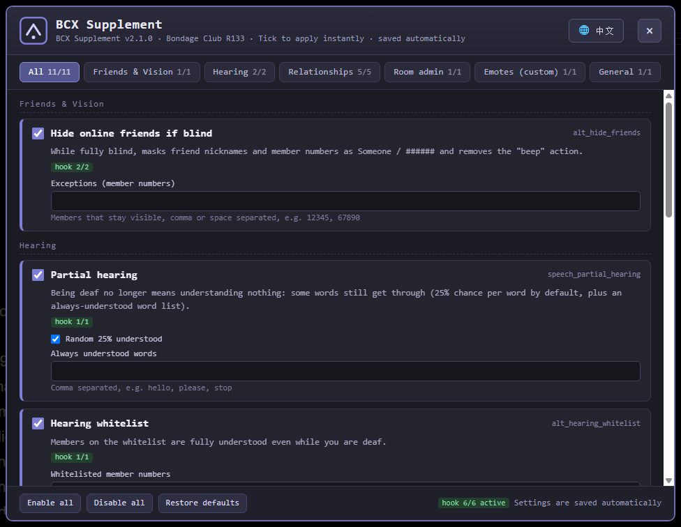
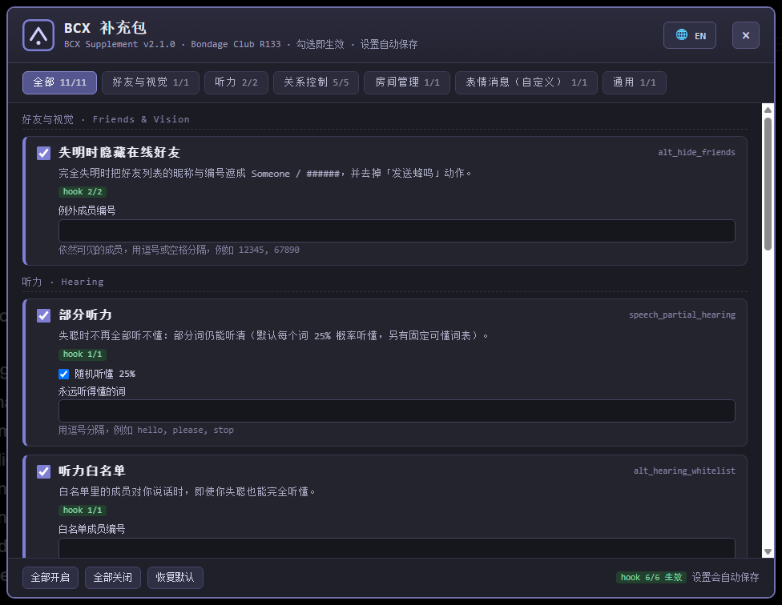

# BCX Broken-Rules Supplement (BC R133)

**English** | [中文](README.md)

Several rules in BCX (Bondage Club Extended) 1.1.22 hook functions that are no longer called by BC R133 — ticking them has no effect at all. This supplement re-implements the core behaviour of those rules with `bcModSdk`, **without modifying BCX itself**, so it can be switched off independently at any time. It also ships one custom rule BCX doesn't have: **forbid sending emote messages while the Head slot is occupied** (the `*`-prefixed Emote chat message — not the facial expression icon on the character's face).

- Main file: `bcx-supplement.user.js`
- Compatibility: BC R128 and above (after the friend-list rework); every hook target verified on R133
- Current version: **v2.1.0** (see [CHANGELOG.md](CHANGELOG.md))
- **Since v2.0 there is an in-game settings panel**: one card per rule, each switchable on its own, with parameter editing and hook status. Entry points: Preferences → Extensions, the floating button on the right edge, or `/bcxfix ui` in chat
- **Since v2.1 the interface is bilingual**: the panel is English by default and the `🌐` button in the header toggles Chinese/English, remembered across sessions

## Install (one click)

Install [Tampermonkey](https://www.tampermonkey.net/) or [Violentmonkey](https://violentmonkey.github.io/), then open the install page and press the button — the extension pops up its install dialog directly:

- Install page: <https://mrc0580.github.io/bcx-supplement/>
- Script direct link: <https://mrc0580.github.io/bcx-supplement/bcx-supplement.user.js>

`@updateURL` / `@downloadURL` are baked into the script header, so what you install is the "self-updating" version:

- Tampermonkey checks once every 24 hours by default; you can also click "Check for userscript updates" in the extension panel to pull it immediately.
- Only the `@version` in the script header is compared — **it updates only when the version number increases**, so every change must bump `@version`.
- After updating, just refresh the game page; there is no need to paste the code again.

### Why github.io instead of raw.githubusercontent.com

Measured on this machine: `raw.githubusercontent.com` **cannot be resolved** in mainland China (`curl` fails immediately, `nslookup` returns no record), so raw links can neither install nor check for updates. `https://mrc0580.github.io/...` is served through the GitHub Pages CDN, is reachable in practice, and **rebuilds automatically on every push**, so there is no long-cache problem.

Alternate sources (identical content; pick one, but if you install from one, change `@updateURL` / `@downloadURL` in the header to match, otherwise update checks still point at the original address):

| Source | URL | Notes |
|---|---|---|
| GitHub Pages (default) | `https://mrc0580.github.io/bcx-supplement/bcx-supplement.user.js` | Updated on every push |
| jsDelivr | `https://fastly.jsdelivr.net/gh/mrc0580/bcx-supplement@main/bcx-supplement.user.js` | Stable, but branch refs are cached for about 12 hours |
| gh-proxy | `https://gh-proxy.com/https://raw.githubusercontent.com/mrc0580/bcx-supplement/main/bcx-supplement.user.js` | Third-party proxy, long-term availability not guaranteed |

---

## 1. Covered rules

| BCX rule | Rule ID | Why it breaks on R133 | Implementation in this supplement |
|---|---|---|---|
| Hide online friends if blind | `alt_hide_friends` | Depends on `button.fl-online-friends-content`, which no longer exists after the R128 "•••" menu rework | Hooks `FriendListLoadFriendList` to rewrite table cells directly; hooks `FriendListGetAvailableActions` to filter out the `beep` action |
| Partial hearing | `speech_partial_hearing` | The hooked `SpeechGarble` has 0 call sites (replaced by `SpeechTransformProcess`) | Hooks `SpeechTransformProcess`, rebuilding garbled text word by word |
| Hearing whitelist | `alt_hearing_whitelist` | Same as above | Whitelisted members return the original text in pure-deafness scenarios |
| Forbid getting new lovers | `rc_lover_new` | `ChatRoomLovershipOptionIs` has 0 call sites | Hooks `ServerSend`, intercepting `Propose` / `Accept` of `AccountLovership` |
| Forbid breaking up with lovers | `rc_lover_leave` | Broken at the menu layer | Hooks `ServerSend`, intercepting `Break` of `AccountLovership` |
| Forbid taking new submissives | `rc_sub_new` | `ChatRoomOwnershipOptionIs` has 0 call sites | Hooks `ServerSend`, intercepting `Propose` of `AccountOwnership` (trial-to-formal transition is allowed) |
| Forbid disowning submissives | `rc_sub_leave` | `ChatRoomIsOwnedByPlayer` has 0 call sites | Hooks `ServerSend`, intercepting `Release` of `AccountOwnership` |
| Forbid club owner changes | `rc_club_owner` | `ChatRoomOwnershipOptionIs` has 0 call sites (the admin-screen hook still works) | Hooks `ServerSend`, intercepting `Accept` (when unowned) and `Break` away from the owner |
| Limit bound admin power | `alt_room_admin_limit` | `ChatRoomAdminAction` has 0 call sites | Hooks `ServerSend`, blocking every `ChatRoomAdmin` action except `Kick` / `Ban` while restrained |
| **Forbid sending emote messages while Head is occupied** (added here; BCX has no such rule) | `forbid_emote_in_mask` | — | Hooks `ChatRoomSendEmote` — `*text`, `/me`, `/action`, `/attempt` and Mu-style `:text` all converge here; when blocked, an announcement is sent to the room; plus an optional `ServerSend` protocol-level backstop |

Not included: the "room is blocked" tooltip of `block_entering_rooms`. The **blocking itself still works** (it goes through `ChatSearchJoin`); only that tooltip in the search results is broken, which is purely cosmetic.

---

## 2. Installation

### Option A: install from this repository (recommended, auto-updating)

1. Install [Tampermonkey](https://www.tampermonkey.net/) or [Violentmonkey](https://violentmonkey.github.io/).
2. Open the install link above — the extension shows its install page; click "Install".
3. Refresh the game page. The console should show:

```
[BCX-Supplement] ✓ hooked FriendListLoadFriendList  (alt_hide_friends)
[BCX-Supplement] ✓ hooked FriendListGetAvailableActions  (alt_hide_friends)
[BCX-Supplement] ✓ hooked SpeechTransformProcess  (speech_partial_hearing + alt_hearing_whitelist)
[BCX-Supplement] ✓ hooked ServerSend  (rc_* / alt_room_admin_limit)
[BCX-Supplement] ✓ hooked ChatRoomSendEmote  (forbid_emote_in_mask（新增）)
[BCX-Supplement] ✓ hooked ServerSend  (forbid_emote_in_mask · 协议层兜底（可选）)
[BCX-Supplement] 已加载 v1.2.2：6/6 个 hook 生效
```

(The last line reads "loaded v1.2.2: 6/6 hooks active".)

The `@match` entries are already in the header, covering `www.bondageprojects.elementfx.com` / `bondageprojects.elementfx.com` / `bondage-club.com`. If you use another mirror, add its domain to `@match`.

### Option B: manual paste (temporary debugging only)

Extension panel → "Add new script" → paste the whole `bcx-supplement.user.js` and save. A script installed this way **will not** follow repository updates (unless you paste `@updateURL` along with it), so switch back to Option A when you're done.

### Option C: FUSAM local development mode

FUSAM can load a local script through a URL parameter (see "Developing an Addon for FUSAM" in the official docs):

1. Serve the directory containing the script, e.g. `python -m http.server 8000`.
2. Open `https://www.bondageprojects.elementfx.com/R133/BondageClub/?fusam=http://localhost:8000/bcx-supplement.user.js&fusamType=eval`
3. A "Local Development" addon appears in FUSAM; toggle it on.

### Option D: quick try (lost on refresh)

Paste the whole file into the console and press Enter — equivalent to Option A, except you have to redo it on every refresh.

> The script registers a single mod named `BCXSupplement` with `bcModSdk`. It writes no BC data and touches no save files; uninstalling means deleting the script and refreshing.

---

## 3. Configuration

Configuration lives in `localStorage["bcx-supplement.config.v1"]`. Three ways to change it — the panel is the recommended one since v2.0.

### Settings panel (new in v2.0, recommended)

One card per rule; ticking a box applies immediately and saves automatically, so there is no key name to memorise.



**Interface language (v2.1):** the panel is **English by default**; the `🌐 中文` button in the header switches to Chinese (the button then reads `🌐 EN`). The choice is stored as `uiLang`, so it survives reloads. You can also run `/bcxfix lang zh` or `/bcxfix lang en`. Rule names, descriptions, field hints, category tabs, footer buttons, the `/bcxfix` status output and the emote self-check all follow the selected language.

中文界面长这样（[README.md](README.md) 用的就是这张图）：



**Three entry points, all opening the same panel:**

| Entry point | How to get there |
|---|---|
| Preferences → Extensions | In game: Preferences → Extensions → "BCX Supplement / 补充包" (same place BCX itself lives) |
| Floating button | The `BCX` round button on the right edge of the screen (can be turned off under General → Show floating button) |
| Chat | Type `/bcxfix ui` and send |

**What the panel gives you:**

- Category tabs across the top, each showing "enabled / total" (e.g. `Hearing 2/2`): All / Friends & Vision / Hearing / Relationships / Room admin / Emotes / General;
- Each card: checkbox + rule name + the original BCX rule id on the right (`alt_hide_friends` and friends, so you can match it against BCX) + a one-line description + a `hook 2/2` status badge;
- The rule's own parameters sit in the same card, no commands needed: whitelisted member numbers, understood-word list, announcement text, cooldown in ms, which equip groups count as the head slot;
- Footer: `Enable all` / `Disable all` / `Restore defaults`, plus `hook 6/6 active` on the right;
- Close with `Esc`, the `×`, or a click on the backdrop.

The rule inventory is the `RULES` array (plus `RULE_GROUPS` for categories). The panel, the `/bcxfix` status output and the toggle list are all generated from it — adding a rule means adding one entry and the UI picks it up.

### Chat command `/bcxfix`

```
/bcxfix ui                    open the settings panel (same as the floating button)
/bcxfix                       show all switches and whitelists
/bcxfix off forbidNewSub      turn one off (key names below)
/bcxfix on forbidNewSub       turn it back on
/bcxfix allowfriend 12345     add/remove 12345 to/from the "visible while blind" list
/bcxfix allowhearing 12345    add/remove 12345 to/from the speech whitelist
/bcxfix word hello            add/remove a word that is always understood
/bcxfix notice <text>         change the "emote blocked" announcement ({name} or $name is replaced by the nickname)
/bcxfix emote                 self-check for the emote rule (start here when it "doesn't work")
/bcxfix group ItemHood        add/remove a group from the Head slot set (default: ItemHead + ItemHood)
/bcxfix lang en|zh            switch the interface language (English by default); an open panel is rebuilt at once
/bcxfix reset                 restore defaults (keeps the interface language)
```

### Console

```js
BCXSupplement.openSettings();  // open the settings panel
BCXSupplement.diag();          // emote-rule self-check (same as /bcxfix emote)
BCXSupplement.config.partialHearingRandom = false;
BCXSupplement.config.partialHearingWords = ["hello", "please"];
BCXSupplement.save();      // without save() the change is lost on refresh
BCXSupplement.status();    // check whether every hook is in place
```

### Key reference

| Key | Default | Meaning |
|---|---|---|
| `hideFriendsWhenBlind` | `true` | While fully blind (blind ≥ 3), mask friend names/numbers and disable beeping |
| `friendsVisible` | `[]` | Member numbers still visible while blind |
| `partialHearing` | `true` | Partially understand garbled speech |
| `partialHearingRandom` | `true` | Each word has a 25% chance of being understood |
| `partialHearingWords` | `[]` | Words that are always understood |
| `hearingWhitelist` | `true` | Speech whitelist on/off |
| `hearingWhitelistMembers` | `[]` | Members whose speech is always understood |
| `hearingWhitelistIgnoreGagged` | `false` | Whether to understand them even when they are gagged |
| `forbidNewOwner` | `true` | Forbid changing owners / leaving the owner |
| `forbidNewSub` | `true` | Forbid taking new subs (trial-to-formal is unaffected) |
| `forbidReleaseSub` | `true` | Forbid releasing subs |
| `forbidNewLover` | `true` | Forbid new lovers (dating → engaged → married unaffected) |
| `forbidBreakLover` | `true` | Forbid breaking up with a lover |
| `limitAdminWhileRestrained` | `true` | While restrained, disable room admin actions other than kick/ban |
| `forbidEmoteWhileHeadOccupied` | `true` | Forbid emote messages (`*`-prefixed Emote messages) while the Head slot (`ItemHead`) is occupied, and announce it to the room |
| `emoteBlockGroups` | `["ItemHead","ItemHood"]` | Which equip groups count as the "Head slot". The Head slot and hoods both count by default (many masks are actually `ItemHood`); add others via `/bcxfix group` |
| `emoteBlockAtProtocol` | `false` | Protocol-level backstop: some chat-enhancement mods bypass `ChatRoomSendEmote` and send messages directly; turn this on to also block in `ServerSend` |
| `emoteNoticeMessage` | `"$name" tries to send an emotion, but failed due to he/she's in a mask` | Announcement template |
| `emoteNoticeCooldownMs` | `1500` | Announcement cooldown to prevent spam (blocking itself is not affected) |
| `emoteKeepInputText` | `true` | Keep the original text in the input box after blocking, so you don't retype it |
| `uiFloatingButton` | `true` | Show the BCX floating button on the right edge (turn it off and use Preferences → Extensions instead) |
| `uiLang` | `"en"` | Interface language, `"en"` or `"zh"`. Change it with the `🌐` button in the panel header or `/bcxfix lang`; `/bcxfix reset` leaves it alone |

---

## 4. Implementation notes

**Every hook target is a function that is still called in R133**, not a deprecated leftover that merely looks present:

- `FriendListLoadFriendList`: builds the friend-list DOM synchronously in R133, so a post-hook can read `.friend-list-row` directly.
- `FriendListGetAvailableActions`: the data source of R133's "•••" menu; action ids are `delete / add / beep / reply / copy / react`, so filtering `beep` matches BCX's old "disable the beep button".
- `SpeechTransformProcess`: R133's speech-processing entry point; the receiver-side effect is always `["deafen"]`, so only that branch is touched.
- `ServerSend`: relationships and room administration all ultimately become `AccountOwnership` / `AccountLovership` / `ChatRoomAdmin` messages, so intercepting at this layer is more robust than hooking each menu function.

**Deferred hooking**: BC's scripts load synchronously in order, so when `bcModSdk` appears the functions in `Screens/*.js` may not be defined yet. The script hooks each target "once the function exists", retrying every 500 ms for up to 60 seconds, so nothing is missed because of load order.

**Priority**: reading the ModSDK source, a higher `hookFunction` priority means an outer wrapper (runs first, post-code runs last). Filter-style hooks therefore use a high priority (10) so they see the final result.

### How the settings panel plugs into the game (v2.0)

The panel is plain DOM appended to `document.body` with a `z-index` above the game canvas. What matters is that the entry point uses BC's official third-party extension API:

```js
PreferenceRegisterExtensionSetting({ Identifier, ButtonText, Image, load, run, click, exit, unload });
```

- After registering, a button shows up under Preferences → Extensions. That is exactly where BCX itself lives, so players find it;
- BC's `PreferenceSubscreenExtensionsRun` keeps calling `run()` and **stops drawing the character**, so the extension must draw its own UI. We append our DOM and leave `run` / `click` empty;
- Closing with the panel's `×` must call `PreferenceSubscreenExtensionsClear()` to get back to the extension list, but when BC itself collapses the screen (`exit` / `unload`) calling it again would drag the user back into the list. That is why `closeSettings(fromGame)` takes a flag to tell the two cases apart;
- The chat command `/bcxfix ui` and the floating button call `openSettings()` directly and skip that lifecycle entirely.

The rule inventory is a single source of truth: `RULES` (each rule plus its `fields`) and `RULE_GROUPS` (categories). The panel, the `/bcxfix` status output, the accepted `on|off` keys and the all-on/all-off buttons are all generated from that table, so adding a rule means adding one entry.

### How the bilingual interface works (v2.1)

There is no second copy of the UI and no string replacement — the same DOM reads its text in the current language:

- **Rule names / descriptions / hints** are written in pairs inside `RULES`: `zh` / `en`, `desc` / `descEn`, `hint` / `hintEn` (the two "added by this supplement" rules also carry `bcxEn`). `nameOf(item)` and `pick(item, "desc")` select one side based on `lang()`, falling back to Chinese when an English string is missing.
- **Panel chrome** (title, subtitle, close tooltip, the "All" tab, the three footer buttons, the `hook n/n` badge, the floating-button tooltip, the Preferences entry name) lives in `L10N.zh` / `L10N.en` and is read with `t("key")`; the one that takes arguments (`hookSum`) is stored as a function.
- **Command output** uses an inline `L("中文", "English")` helper, so `/bcxfix` status and the `/bcxfix emote` self-check follow the language too.
- **Switching does not reload the page**: `setLang()` writes `uiLang` and calls `rebuildSettings()`, which tears the panel down and rebuilds it in the new language while restoring the active category tab and scroll position — switching while on "Relationships" does not jump back to "All".
- **`/bcxfix reset` does not touch `uiLang`**: language is an interface preference, not a rule, so resetting rules keeps it.

When you add a rule or a field later, write `en` / `descEn` / `hintEn` alongside it and the English UI is complete automatically; anything missing falls back to Chinese rather than showing a blank.

### How the added rule "forbid emote messages while Head is occupied" works

First, what exactly is blocked: an **emote message** is chat content with `Type: "Emote"` on the receiving side, displayed in the room as a line of italic text; a **facial expression** is the emotional icon on the character's face (blush, frown, etc.). The two are unrelated in BC, and this rule governs the former.

In R133 there is only one mandatory path for player-initiated emote messages (`ChatRoom.js:3500`); every syntax converges on the same function:

```
*text                       typed in chat, prefix detected at ChatRoom.js:3352
50%*text                    emote with a success chance
/me text                    CommandsDefault.js:448
/attempt 50% text           CommandsDefault.js:455
/action text                CommandsDefault.js:461 (becomes **text internally)
:text                       alternative syntax with MuStylePoses enabled
        ↓
ChatRoomSendEmote(msg)
        ↓
ChatRoomGenerateChatRoomChatMessage("Emote", msg)
        ↓
ServerSend("ChatRoomChat", { Type: "Emote", ... })
```

So hooking `ChatRoomSendEmote` alone covers every syntax; when blocked, `next` is not called and the message never reaches the protocol layer.

A few details:

- **The condition** is that `InventoryGet(Player, "ItemHead")` is non-null, i.e. the Head slot in the wardrobe holds something (masks, hoods and hats all count). If `InventoryGet` is unavailable it falls back to scanning `Player.Appearance`.
- **Why not fall back to `ServerSend`**: `WheelFortune.js:904/944/957` send three automatic `Emote` narrations (wheel results). Those are built-in game narration, not "the player sending an emote", and blocking at the protocol layer would hit them by mistake.
- **Input restore**: `ChatRoomSendChat` clears the input box unconditionally after calling `ChatRoomSendEmote` (`ChatRoom.js:3354`), so on blocking the original text is written back in a microtask to save the player from retyping. Set `emoteKeepInputText` to `false` to disable this.
- **The announcement uses `Type: "Emote"`, not `"Action"`.** In R133 a received `Action` passes `Content` to `TextQueryMultiple` for localization lookup (`ChatRoom.js:4562`), and custom text gets replaced by the `⚠️MISSING TEXT` placeholder; `Emote` does no lookup. Because the content starts with `*`, the receiver-side Emote formatter (`ChatRoom.js:3782`) won't prepend the sender name again, so the room finally shows an italic line: `"Alice" tries to send an emotion, but failed due to he/she's in a mask`.
- **The announcement has a 1.5-second cooldown**, but the blocking itself applies every time.
- Incidentally, BC has its own semantically identical room-owner rule `BlockEmote` (that `ChatRoomOwnerPresenceRule("BlockEmote")` at `ChatRoom.js:3502`) for comparison.

---

## 5. Differences from the original BCX rules (important)

The supplement uses **global switches** and has none of BCX's "who it applies to" condition system:

1. **No per-target conditions.** BCX rules are evaluated per target character/relationship (e.g. "only when the target is your owner"). Here "on" means "applies to everyone". If you only want it to apply to specific people, turn the corresponding switch off and rely on the still-working parts of the native BCX rules, or modify the script.
2. **BCX whitelists are not read.** BCX stores `allowedMembers` / `whitelistedMembers` in its own rule data, which this supplement cannot access — you need to re-enter them via `/bcxfix`.
3. **Relationship blocking happens at the protocol layer**, therefore:
   - what is blocked is "the message doesn't go out"; buttons in the UI do not grey out;
   - in extreme cases (another client or script sending the protocol directly) it can still be bypassed — the same level as the original BCX rules.
4. **Speech rebuilding uses its own per-word algorithm** (calling `SpeechTransformGagGarble` word by word, like BCX). The random sequence won't match BCX character for character, but the "proportion understood" does.
5. Once BCX officially fixes a rule, turn off the corresponding switch here to avoid double handling.

---

## 6. Self-test checklist

| Item | Action | Expected |
|---|---|---|
| Friend masking | Wear a blindfold that brings blind ≥ 3 → open the friend list | Names become `Someone`, numbers become `######`; whitelisted members are unchanged |
| Beep | In the same state, click "•••" on a friend row | No "Beep" entry in the menu |
| Normal state | Take the blindfold off and reopen the friend list | Names and numbers restored (the list re-renders) |
| Partial hearing | Wear earplugs to reach deaf ≥ 2 and let a normal character speak | Most syllables garbled, about 1/4 of words recognizable |
| Hearing whitelist | Add the other party's number via `allowhearing` | Their speech is fully readable |
| Relationship control | Make an ownership proposal to an unrelated character | Chat shows "your rules don't allow you to take new subs"; the proposal is not sent |
| Trial-to-formal | Promote your own trial sub | Sent normally (unaffected) |
| Admin limit | While restrained and an admin, move a character in the room | Shows "cannot perform room administration while restrained"; the action is not sent |
| Kick | Same as above, kick someone | Executes normally |
| Emote blocked by Head item | Put anything in the Head slot, type `*waves` in chat and press Enter | Message not sent, the text is restored to the input box, and an italic announcement appears: `"Alice" tries to send an emotion, but failed due to he/she's in a mask` |
| Other emote syntaxes | In the same state try `/me waves`, `/action waves`, `/attempt 50% waves` | Blocked the same way, with the same announcement (shared 1.5 s cooldown) |
| Normal speech | In the same state type `hello` (no `*`) | Sent normally (this rule doesn't touch normal chat) |
| Facial expression | In the same state change the face expression (via the expression panel) | **Unaffected**, works normally (this rule doesn't touch facial expression icons) |
| Remove the head item | Take the Head slot item off and send `*waves` | Sent normally |
| Status check | `/bcxfix` | Shows the 15 switches + whitelists + the current Head item + whether all hooks are active |
| Emote rule self-check | `/bcxfix emote` | Shows the switch, monitored groups, hook state, the item in each group, the current verdict, and how many times it blocked |
| Interface language | `🌐` in the panel header / `/bcxfix lang` | English ⇄ Chinese; the panel rebuilds at once and the choice is stored in `uiLang` |
| Settings panel | Preferences → Extensions → "BCX 补充包 / Supplement" | Panel opens with 7 category tabs and 11 rule cards, footer shows `hook 6/6 生效` |
| Floating button | Click the `BCX` round button on the right edge | Same panel; can be turned off under General → Show floating button |
| Panel switch | Untick "Hearing whitelist" | The card dims, and it is still off after a page refresh (written to localStorage) |
| All off / all on | Click `全部关闭` then `全部开启` at the bottom | Every card follows; the emote rule stops/restarts working |
| Turning the blind rule off | While blind open the friend list, then untick "Hide online friends if blind" in the panel | Already masked rows immediately show their real name and number again |

If `/bcxfix` reports inactive hooks, send me the `[BCX-Supplement]` console logs — it most likely means BC changed again.

---

## 7. Release procedure (how to make Tampermonkey update after a change)

Tampermonkey decides whether to update based on `@version` in the script header, so every change just has to follow three steps:

1. **Edit the code**: modify `bcx-supplement.user.js`.
2. **Bump the version**: change `// @version      1.2.1` to `1.2.2` (small fix) or `1.3.0` (new rule).
   The version must increase in three `major.minor.patch` segments — **no bump, no update**.
3. **Push**:

```bash
git add -A
git commit -m "fix: fix xxx"
git push
```

Within 24 hours after pushing (or immediately via "Check for userscript updates"), Tampermonkey pulls the new version; refresh the game page to apply it.

For a one-command release you can add an npm script, or just run the following (after editing):

```bash
# auto-increment the patch number, commit and push
node -e "const fs=require('fs');const p='bcx-supplement.user.js';let s=fs.readFileSync(p,'utf8');s=s.replace(/@version\s+(\d+)\.(\d+)\.(\d+)/,(m,a,b,c)=>'@version      '+a+'.'+b+'.'+(+c+1));fs.writeFileSync(p,s);"
git commit -am "chore: bump version"
git push
```

### Keeping the two READMEs in sync

- `README.md` is the Chinese version, `README.en.md` is this English version. **They must be updated together** — any change to rules, config keys, screenshots, or the release flow has to land in both files in the same commit.
- When adding a version entry, `CHANGELOG.md` keeps a single copy (Chinese primary); mention documentation-only changes there too.

`docs/BCX-rule-breakage-report.md` is the original investigation report, kept as the rationale for "why it is written this way"; it is not loaded at runtime.

---

## 8. Troubleshooting a rule that "doesn't work" (using the emote rule as the example)

Since v1.2.2 there is a built-in self-check. Go through it in this order (the commands go into the **in-game chat box**, not the browser console — a leading `/` is parsed as a regex there and throws `Invalid regular expression`; in the console use `BCXSupplement.diag()` instead):

1. **Confirm the script version**: the Tampermonkey dashboard must show `2.0.0` or newer (`2.1.0`+ for the bilingual UI). Version 1.1.x blocked the facial-expression icon rather than `*text`; 1.2.0/1.2.1 had the two bugs listed below. Click "Check for userscript updates" once, or reinstall from the install page.
2. **Confirm all 6 hooks are green**: search the console for `[BCX-Supplement]`; the last line should read `已加载 v2.1.0：6/6 个 hook 生效`.
3. **Type `/bcxfix emote` in chat** and check each line:
   - `开关 …：关` → run `/bcxfix on forbidEmoteWhileHeadOccupied`
   - `ChatRoomSendEmote hook：未挂载` → BC changed again; send me the console log
   - `ItemHead：InventoryGet=空，扫描=空` and `ItemHood` is empty too → what you wear is in neither default group; look at the "head-related groups" line below and add that group with `/bcxfix group <group>`
   - `当前判定：不会拦截` → one of the lines above is not satisfied
4. **Wear the head item, send `*waves`, then look at `已拦截 N 次` in `/bcxfix emote` again**:
   - N becomes 1 → the rule works. If the message still went out, something else is sending it for you (macro, newline send, another mod)
   - N stays 0 → the message never goes through `ChatRoomSendEmote` (typical of chat-box replacement mods such as WCE) → run `/bcxfix on emoteBlockAtProtocol` and try again

The two bugs fixed in v1.2.2 both looked like "nothing happens and the console reports no error":

| Problem | Cause | Fix |
|---|---|---|
| Cross-family items were not detected | `InventoryGet` additionally requires `Group.Family === Player.AssetFamily` (`Inventory.js:681`), so neutral/cross-family headwear was treated as "nothing equipped" | The check now tries the official API first and then falls back to scanning `Player.Appearance` directly, without comparing families |
| The script crashed when the SDK was already present | `waitForSdk()` used to be called early in the file; when `bcModSdk` already existed `boot()` ran synchronously while `let` state further down was still in its TDZ, so the first hook invocation threw `ReferenceError` and the whole script failed to load | `waitForSdk()` moved to the end of the file, so all state is initialized before booting |
